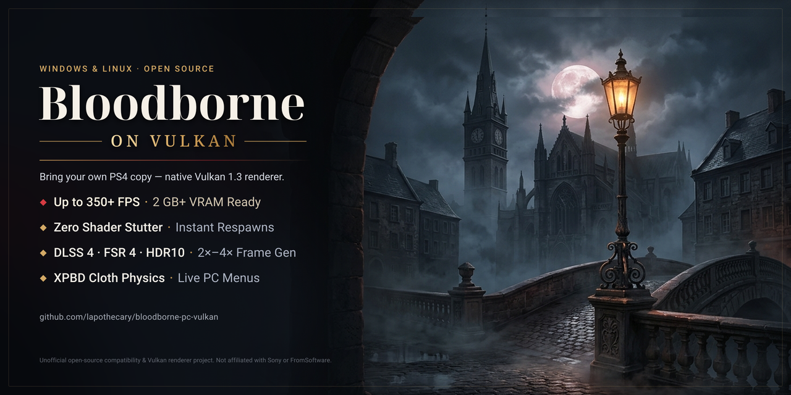

<p align="center">
  <a href="https://github.com/lapothecary/bloodborne-pc-vulkan/releases/latest">
    
  </a>
</p>

<p align="center">
  <a href="https://github.com/lapothecary/bloodborne-pc-vulkan/releases/latest"><b>📦 Download Latest Release</b></a> •
  <a href="#-quick-start"><b>⚡ Quick Start</b></a> •
  <a href="#-key-features"><b>✨ Key Features</b></a> •
  <a href="#-more-details"><b>🔍 Comparisons & Specs</b></a> •
  <a href="#-документация-на-русском-языке-ru"><b>🇷🇺 На русском</b></a>
</p>

<p align="center">
  <code>Windows 10/11 &amp; Linux (x86_64)</code> · <code>2,940 Decompiled C++20 Engine Functions</code> · <code>152 Native Vulkan Shaders</code> · <code>3,995 Pre-Bake Recipes</code> · <code>1-Click Auto-Updater</code>
</p>

An optimization-focused **Windows 10/11** and **Linux (`x86_64`)** PC port for **Bloodborne** (`CUSA03173` / `CUSA00900` v1.09), built on top of [`bbport`](https://github.com/deadinside28/bloodborne_pc) and [`shadPS4`](https://github.com/shadps4-emu/shadPS4).

Instead of emulating raw PS4 GPU memory traps and heavy legacy shaders on every frame, this project refactors the core graphics pipeline of FromSoftware's **Dantelion2** engine into native **C++20** and **Vulkan 1.3** (`DirectVk`) — delivering much higher frame rates, lower VRAM/RAM usage, stutter-free gameplay, and a native PC experience right inside Bloodborne's own menus.

---

## ⚡ Quick Start

> **Legal Notice:** This repository contains **zero** Sony or FromSoftware game assets or executables (`eboot.bin`). Provide your own legally dumped *Bloodborne* v1.09 folder (`CUSA03173` or `CUSA00900`; split `CUSAxxxxx` + `CUSAxxxxx-patch` folders are detected automatically).

| Platform | Download from [Releases](https://github.com/lapothecary/bloodborne-pc-vulkan/releases/latest) | How to Play |
| :--- | :--- | :--- |
| 🪟 **Windows 10/11 (`x86_64`)** | `bloodborne-pc-vulkan-windows-x86_64-prebuilt.zip` | Extract next to `CUSA03173` and run **`Bloodborne.exe`** (or **`Launcher.exe`** for mods/updates/pre-bake) |
| 🐧 **Linux (`x86_64`)** | `bloodborne-pc-vulkan-linux-x86_64-prebuilt.tar.gz` | Extract next to `CUSA03173` and run **`./play.sh`** (or **`./launcher.sh`**) |

```text
BloodBorne/
├── CUSA03173/                      # Your dumped Bloodborne v1.09 folder (eboot.bin, dvdroot_ps4/, ...)
└── bloodborne-pc-vulkan/           # Extracted release folder:
    ├── Bloodborne.exe / play.sh    # Direct launch (zero Python in RAM during gameplay)
    ├── Launcher.exe / launcher.sh  # Lightweight native C++20 Launcher
    └── ...
```

**Handy In-Game Shortcuts:** `F4` cycles Camera Follow Mode (`Original` / `Balanced` / `Locked`) • `F3` cycles FPS cap • `F8` / `F9` toggles performance HUD • `Insert` opens the overlay • `Alt+Enter` toggles Fullscreen / Borderless. Default PC controls (`V` Blood Vial, `R` Quick Item, `Q` Lock-On, `3` Blood Bullets, `4`/Wheel Down switch item, `Left Alt` Slow Walk) are all rebindable in `System -> Controls`.

---

## ✨ Key Features

- **Authentic Native Launcher (Zero Bundled Game Assets)** — Fast, frameless C++20 launcher with 1-click SHA-256 updates, unified gothic hover tooltips, Mods, Online (`bbnet20`), and live Shader/Recipe Pre-Bake counter. On first run it decodes Bloodborne's own title art, official Victorian font (with full Cyrillic support), menu SFX, and ambient music (*Hunter's Dream* & *Omen*) straight from your local game files.
- **Full-Game Shader Pre-Bake (`5,761` Shaders + `3,995` Recipes)** — Pre-compile all game shaders once in the launcher (~4 s on Linux!) or let the quiet background auto-baker finish while you play, with zero-stutter async compile fallback during combat.
- **Runs Even on `2–4 GB VRAM` GPUs** — True split PC VRAM (`DEVICE_LOCAL`), Vulkan memory priority pinning, bounded UI-upscale cache, live **`Texture Quality`** (saving up to ~1 GB VRAM on the fly), and `16:10` / `1366×768` support make Bloodborne smooth all the way from `GTX 1050 2 GB` up to `RTX 4090`.
- **Silky-Smooth Frame Pacing & `1000+ Hz` Mouse Camera** — Overhauled multi-core L3/P+E CPU scheduling, dual-stage frame/present pacing (`~0.13–0.49 ms` jitter), **NVIDIA Reflex** low latency, and event-driven mouse input remove camera stutter at 60–300+ FPS (with automatic slow-motion protection below FPS caps).
- **Smooth `Balanced` Camera Mode (`F4`)** — Inspired by *Lies of P*'s smooth camera feel and refined for Bloodborne: strafing, sprinting, and climbing stairs flow smoothly without jarring camera jerks. Switch live anytime between `Original (PS4)`, `Balanced`, and `Locked (1:1)`.
- **Enhanced High-FPS Cloth Physics & Smooth Ladders** — Choose **`Cloth Physics`** live in `System -> Display`: `Default`, `Native Smooth`, or **`Enhanced (XPBD)`** for fluid, tangle-free coats, capes, and belts at 60–500 FPS, plus smooth rung-by-rung ladder climbing/sliding and proper grass wind.
- **Complete Live In-Game PC Menu & Controls** — Rebind any keyboard/mouse key (including mouse wheel) and adjust resolution, **`Texture Quality`**, **`Shadow Quality`** (`Off` to `8K Ultra PCSS`), **`Cloth Physics`**, live `VSync`, upscalers, Frame Generation, and effects right inside Bloodborne's `System` menu — complete with gothic scrollbars and `Exit Game` on the Title Screen.
- **~1.3 s Death Respawns & ~2–3 s Loading** — Accelerated decompression and loading-screen pacing drop death respawns from `~12.6 s` down to **~1.3 s** and warps to ~2–3 s (with optional **`Loading Screen Tips Timer`** toggle in `System -> Controls`).
- **Upscaling, Frame Generation, Native HDR10 & Remaster Visuals** — Live **`DLSS 4.5 / 4 / DLAA / FSR 3.1 & 4 / XeSS / SMAA T2x`**, **`DLSS` & `FSR 3.1` Frame Generation (`2×–4×`)**, free `RCAS` sharpening, `2×/4×` GPU UI & icon upscaling, **`152` native Vulkan shaders**, true 10-bit **`HDR10`**, plus optional remaster toggles (`GTAO/SSAO`, `PCSS`, denoised `SSGI`, `Contact Shadows`, `Adaptive SSR`, `Fire Heat Haze`, and `True Black / OLED`).
- **Single-Process Native Execution & Privacy-Safe Diagnostics** — Only `Bloodborne.exe` / `bb-vulkan` stays in memory during gameplay with zero Python overhead, automatic user-path-redacted Crash Black-Box reports (`logs/crash-*.log`), and anonymized `logs/recipes/unknown_recipes.bbrc` capture to expand community shader coverage.

---

> **Hardware Requirements:** Because this port executes Bloodborne's original PS4 (`AMD Jaguar x86_64`) code natively on your CPU, it requires a **Vulkan 1.3 GPU (`2 GB+ VRAM`)** and an **x86-64-v3 CPU** supporting `AVX`, `BMI1`, `MOVBE`, `LZCNT`, and `POPCNT` (**Intel Haswell 4th-gen Core 2013+** or **AMD Ryzen / Steam Deck**; older pre-2013 CPUs such as Ivy Bridge `i7-3770K` or Sandy Bridge are not supported).  
> **Public Beta & Hardware Testing:** Heavily verified on **NVIDIA GPUs (`GTX 1050 2 GB`, `RTX 3080`, `RTX 4070 Laptop`, `RTX 4090`)** with **AMD Ryzen** and **Intel Hybrid** CPUs on Windows 10/11 and Linux. **AMD Radeon**, **Intel Arc**, and **Steam Deck** testers are very welcome — if you hit a bug, freeze, or uncached shader, please open a GitHub Issue with your `logs/` folder (`logs/recipes/unknown_recipes.bbrc` helps improve pre-baking for everyone, and 1-click updates ship fixes straight to your launcher!).  
> **Linux Launcher Audio Tip (Arch / CachyOS):** Launcher BGM/SFX uses WebKitGTK + GStreamer — if launcher audio is silent on minimal installs, install `gst-plugins-base gst-plugins-good gst-plugin-pipewire`.

## 🆕 Recent Highlights

- **Live `Cloth Physics` (`Default` / `Native Smooth` / `Enhanced XPBD`)** — Switch cloth simulation live in `System -> Display` for ultra-smooth coats, capes, and belts at any frame rate (60–500 FPS) with zero jitter or stretched waist straps.
- **DLSS & FSR 3.1 Frame Generation (`2×–4×`) + NVIDIA Reflex** — Hardware DLSS Frame Generation on RTX 40/50 and universal FSR 3.1 `2×/3×/4×` Frame Generation on any Vulkan 1.3 GPU, paired with Reflex low-latency pacing.
- **Low-VRAM (`2–4 GB`) & Windows Stability Overhaul** — Dedicated VRAM priority & budget management, bounded UI-upscale cache, Windows DXGI flip-queue stall fix, `16:10` / `1366×768` resolution fixes, and instant VRAM release when toggling effects off.
- **C++20 Engine Audit, Blood & Lighting Polish** — Full static audit across all `2,940` decompiled graphics functions, fixed persistent character/clothing blood mipmaps, refined `SSGI` with a smooth À-Trous denoiser (off by default), updated default PC controls (`V`/`R`/`Q`), and persistent `Insert` overlay layout.

*(See [Releases](https://github.com/lapothecary/bloodborne-pc-vulkan/releases) for clean per-version changelogs.)*

---

## 🔍 More Details

<details>
<summary><b>1. 🆚 How Does This Compare to <code>shadPS4</code> and Upstream <code>bbport</code>?</b></summary>
<br/>

| Area | `shadPS4` | Upstream `bbport` | **`bloodborne-pc-vulkan`** |
| :--- | :--- | :--- | :--- |
| **Execution Model** | General-purpose PS4 emulator | Host runtime + PS4 graphics translation | `bbport` host runtime + **refactored C++20 Dantelion graphics engine** (`2,940` functions) wired into **DirectVk 1.3** |
| **VRAM & Memory** | Unified memory page traps | Shared host RAM + hot VRAM mirrors | **True split PC VRAM (`DEVICE_LOCAL`)** — `0` page faults/s in gameplay, much lower RAM & VRAM footprint |
| **Shaders & Stutter** | Runtime translation | Runtime translation + recipe cache | **Full `5,761`-shader + `3,995`-recipe pre-baker**, quiet background auto-baker, fast async shader fallback, and **`152` native Vulkan GLSL shaders** |
| **Performance Features** | Frame-rate patches | Two-stage draw pipe + Vulkan occlusion | **DirectVk command stream**, **3D occlusion culling (`27–41%` skipped)**, light-tile/UI batching, multi-core AMD/Intel L3 & P+E scheduling |
| **PC Polish & UX** | External emulator UI | Upscalers (`DLSS`/`FSR`/`FG`), Ultrawide, raw mouse, basic in-game menus, online | **Full live in-game `Display`/`Effects`/`Controls` menus (live `Texture`/`Shadow Quality`, `HDR10`, `PCSS`, `SSGI`)**, **smooth `Balanced` camera (`F4`)**, **~1.3 s respawns**, **high-FPS cloth & ladders**, **dual-stage frame pacing**, **authentic C++20 native launcher**, and **1-click updates** |

</details>

<details>
<summary><b>2. 📊 Verified Reference Performance (Desktop &amp; Laptop @ 2560×1440)</b></summary>
<br/>

> Measured in real gameplay logs across three hardware tiers (`0` faults/s, `0` runtime shader compiles after pre-bake):

| Hardware &amp; OS | Scenario (`2560×1440`) | Frame Rate | Frame Pacing / Jitter | Per-Process VRAM |
| :--- | :--- | :---: | :---: | :---: |
| **Ryzen 9 7950X + RTX 4090** (Linux) | Heavy Central Yharnam (`Native DLAA`, all FX) | **340 – 370 FPS** *(or locked `170.0 FPS`)* | `0.13 – 0.15 ms` jitter (`p50 5.88 / p99 5.91 ms`) | `~3.1 – 3.9 GB` |
| **Ryzen 9 7950X + RTX 4090** (Linux) | Enclosed Areas (e.g. Hunter's Dream, Native) | **480 – 700+ FPS** | `1.31 – 1.95 ms` pure GPU | `~2.6 – 3.1 GB` |
| **Ryzen 9 5950X + RTX 3080** (Win 10) | Reflective Water Zone (`m24_01_00_00`, `Native 1440p` `SQ=Ultra`) | **164 – 216 FPS** | `0` faults/s, `MidBubble 0.00 ms` | `~3.4 GB` |
| **Ryzen 9 5950X + RTX 3080** (Win 10) | Reflective Water Zone (`DLSS 3` Ultra Perf, `Cap 240` / `Cap 120`) | **211 – 226 FPS** *(or locked `119.6 FPS`)* | `0.20 – 0.53 ms` jitter (`99%` GPU busy) | `~3.3 – 3.4 GB` |
| **Core i7-13620H `6P+4E` + RTX 4070 Laptop** (Win 11) | Central Yharnam (`Native 1440p` / `DLSS`) | **104 – 130 FPS** *(Native)* · **113 – 145 FPS** *(DLSS)* | `0.61 – 1.38 ms` jitter (`100%` GPU-bound Native) | `~2.6 – 3.4 GB` |

</details>

<details>
<summary><b>3. 🛠️ Building from Source & Diagnostic Flags</b></summary>
<br/>

```bash
# 1. Build the refactored C++20 graphics engine (dantelion_gx):
cmake -S dantelion_gx -B dantelion_gx/build -G Ninja -DCMAKE_BUILD_TYPE=Release
ninja -C dantelion_gx/build

# 2. Build the Vulkan 1.3 RHI library (Linux):
ninja -C build_gpu && cp -f build_gpu/libbbgpu.so out/gpu/libbbgpu.so

# 3. Build the native C++20 WebView Launcher (Linux):
cmake -S launcher_v2 -B launcher_v2/build -G Ninja -DCMAKE_BUILD_TYPE=Release
ninja -C launcher_v2/build && cp -f launcher_v2/build/bb-launcher out/bb-launcher
```

**Useful Runtime Flags (No Rebuild Needed — full list in [`docs/ENVIRONMENT.md`](docs/ENVIRONMENT.md)):**
```bash
BB_HW_OCCLUSION_CULL=0 ./play.sh        # Disable 3D hardware occlusion culling
BB_NATIVE_SHADERS=0 ./play.sh           # Fall back from native GLSL to translated SPIR-V
BB_GX_MODULES="01,02,03,04,07" ./play.sh # Enable only selected C++20 graphics modules for debugging
```

</details>

<details>
<summary><b>4. 🇷🇺 Документация на русском языке (RU)</b></summary>
<br/>

### О проекте
Оптимизированный ПК-порт **Bloodborne** (`CUSA03173` / `CUSA00900` v1.09) для **Windows 10/11** и **Linux (`x86_64`)**, созданный на базе [`bbport`](https://github.com/deadinside28/bloodborne_pc) и [`shadPS4`](https://github.com/shadps4-emu/shadPS4). Вместо эмуляции тяжёлого PS4-рендера на каждом кадре критическая графическая часть движка **Dantelion2** переписана в нативный **C++20** и **Vulkan 1.3** (`DirectVk`), а самые тяжёлые шейдеры заменены чистыми Vulkan-шейдерами.

### Быстрый старт (30 секунд)
1. Скачайте архив для **Windows** (`.zip`) или **Linux** (`.tar.gz`) из раздела **[Releases](https://github.com/lapothecary/bloodborne-pc-vulkan/releases/latest)**.
2. Распакуйте его рядом со своей папкой игры **`CUSA03173`** (`v1.09`).
3. Запустите **`Bloodborne.exe`** / **`Launcher.exe`** (Windows) или **`./play.sh`** / **`./launcher.sh`** (Linux).

### Что делает этот порт удобным для игры
- **Аутентичный нативный лаунчер** — быстрый C++20 лаунчер с автообновлением в 1 клик, едиными готическими подсказками, модами, онлайном и предкомпиляцией шейдеров. Не хранит защищённых файлов Sony: при первом запуске сам декодирует прямо из вашей папки игры родной арт, официальный шрифт Bloodborne (с кириллицей), звуки меню и музыку *Hunter's Dream* / *Omen*.
- **Работает даже на картах с `2–4 ГБ VRAM`** — раздельный ПК-VRAM с приоритетами памяти, ограниченный кэш UI-апскейлера, живое переключение **`Texture Quality`** (экономия до ~1 ГБ VRAM на лету) и поддержка `16:10` / `1366×768` (проверено от `GTX 1050 2 GB` до `RTX 4090`).
- **Полный пре-бейк (`5,761` шейдер + `3,995` рецептов)** — один раз прогоняется в лаунчере (~4 сек на Linux) или тихо в фоне во время игры, убирая статтеры компиляции шейдеров.
- **Плавная камера, фреймпейсинг и новая физика ткани на 60–500 FPS** — событийный опрос мыши `1000+ Гц`, **NVIDIA Reflex**, планировщик под многоядерные AMD и Intel `P+E` (`~0.2–0.5 мс` джиттер), режим плавной камеры **`Balanced`** (`F4`), настройка **`Cloth Physics`** (`Default` / `Native Smooth` / **`Enhanced XPBD`**) прямо в `System -> Display` и плавные лестницы.
- **Полноценные ПК-настройки и удобное управление прямо в игре** — переназначение любых клавиш и колеса мыши (по умолчанию: `V` лечение, `R` предмет, `Q` захват цели, `3` пули, `4`/колёсико вниз — слот, `Left Alt` шаг), живое переключение **`Texture Quality`**, **`Shadow Quality`** (`Off` до `8K Ultra PCSS`), разрешение, `VSync`, **`HDR10`**, апскейлеры (`DLSS 4.5 / DLAA / FSR 3.1 & 4 / XeSS / SMAA T2x`), **генерация кадров (`DLSS` и `FSR 3.1 2×–4×`)**, скроллбары и `Exit Game` прямо в меню.
- **Возрождение за ~1.3 секунды** — переходы и смерти занимают ~1.3–3 секунды вместо 11–12 (при желании таймер подсказок на загрузках можно вернуть обратно прямо в `System -> Controls`).
- **Нативный Vulkan Post-FX и опциональные ремастер-эффекты** — `152` нативных Vulkan-шейдера, `GTAO/SSAO`, `PCSS`, улучшенный `SSGI` с денойзером, `Fire Heat Haze`, контактные микро-тени, адаптивный `SSR`, `True Black / OLED` и `2×/4×` апскейл интерфейса и иконок.
- **Помощь в тестировании** — порт плотно проверен на видеокартах NVIDIA (`GTX 1050 2 GB`, `RTX 3080`, `RTX 4070 Laptop`, `RTX 4090`) на Windows 10/11 и Linux. Будем рады тестам на **AMD Radeon**, **Intel Arc** и **Steam Deck**: если поймаете баг или вылет, скидывайте папку `logs/` (включая `logs/crash-*.log`) в GitHub Issues — пути с именем пользователя автоматически скрываются.

</details>

---

## 📜 Credits & License

- **[`bbport` (`deadinside28/bloodborne_pc`)](https://github.com/deadinside28/bloodborne_pc)** — Host ELF/PE loader, PS4 kernel/system runtime, Windows port foundation, upscaler bridges (`DLSS`, `FSR 3.1/4`, `Frame Gen`), Ultrawide, Havok cloth fixes, raw mouse look, and online (`bbnet20`).
- **[`shadPS4` (`shadps4-emu/shadPS4`)](https://github.com/shadps4-emu/shadPS4)** — Original PS4 Vulkan video core and GCN-to-SPIR-V shader recompiler foundation (`GPL-2.0-or-later`).
- **[`yharnam-pc` (`Jgamrot/yharnam-pc`)](https://github.com/Jgamrot/yharnam-pc)** — UX layout inspiration for the slim-rail launcher and first-time setup flow (`GPL-2.0`).
- **`bloodborne-pc-vulkan` ([@lapothecary](https://github.com/lapothecary))** — Refactored C++20 Dantelion graphics engine, DirectVk split VRAM & occlusion/batching pipeline, `152` native Vulkan shaders, full `5,761`-shader + `3,995`-recipe pre-baker, frame pacing & `Balanced` camera, expanded live in-game menus (`Texture`/`Shadow Quality`, `HDR10`, `PCSS`, `SSGI`), ~1.3 s respawns, high-FPS cloth & ladder fixes, optional remaster shaders, and the native C++20 runtime-decoding launcher.
- **License:** **[GNU General Public License v3.0](LICENSE)** (`GPL-3.0`).
